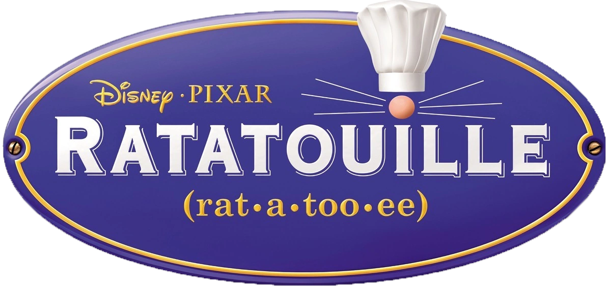

# Ratatouille Patch

Play **Disney-Pixar Ratatouille** (Wii) with a **GameCube controller** or a
**Classic Controller**. The game only accepts a Wii Remote + Nunchuk; this patch
makes either pad look like one to the game. Works with all six retail discs:

| Disc | Release |
| --- | --- |
| `RLWE78` | USA |
| `RLWP78` | UK, Australia |
| `RLWW78` | Scandinavia |
| `RLWX78` | Europe (French, German, Dutch) |
| `RLWY78` | Europe (Italian, Greek) |
| `RLWZ78` | Europe (Spanish, Portuguese) |

The patch is applied to your own copy of the game: drop a clean `.wbfs` or `.iso`
onto the patcher and play the result on a Wii (USB loader) or in Dolphin. Nothing
from the game is included in this repository.



## Status

Tested in Dolphin on the USA disc (scripted GameCube and Classic Controller input
driving the menus and the name-entry pointer). The other five releases are checked
against their retail `main.dol` files and by running the injected code in an
emulator, but not yet played. **Not tested on a real Wii.**

## Controls

| GameCube pad | Classic Controller | Becomes |
| --- | --- | --- |
| Control stick | Left stick | Nunchuk stick |
| C-stick | Right stick | Pointer (menus, HOME Menu) |
| A | a | A |
| B | b | B |
| X | x | 1 |
| Y | y | 2 |
| Start | + | + |
| Z | − | − |
| L | L / ZL | Nunchuk Z |
| R | R / ZR | Nunchuk C |
| D-pad | D-pad | D-pad |
| — | HOME | HOME (also recentres the pointer) |

A GameCube pad on port *n* drives Wii Remote channel *n*. Plug it in before starting
the game. A Classic Controller works as usual, plugged into the Wii Remote.

## Using it

Download the patcher for your system from the releases, run it and drop the disc image
on the window. The original is kept next to it as `<name>.bak`. Or from a terminal
(needs [wit](https://wit.wiimm.de/) on `PATH`):

```bash
python3 tools/patch_disc.py "Ratatouille (USA).wbfs"
```

## How it works

One instruction in `KPADRead` (after its sample loop) is replaced by a branch to a
routine stored in the Wii's boot-time scratch area (`0x80001820`+), which the game never
touches (`tools/verify.py` checks that). The routine rewrites the caller's samples into
Nunchuk samples and synthesises the pointer; KPAD's own state is never touched.
See [docs/TECHNICAL.md](docs/TECHNICAL.md).

## Building

`src/pad.s` is assembled with devkitPPC by `tools/gen_prebuilt.py` into
`tools/prebuilt/*.json`, which is all the patcher needs. `tools/check.py` runs without
game files; `RAT_DOLS=<dir> python3 tools/verify.py` checks against retail DOLs.
`tools/lab/` holds the Dolphin test harness.
